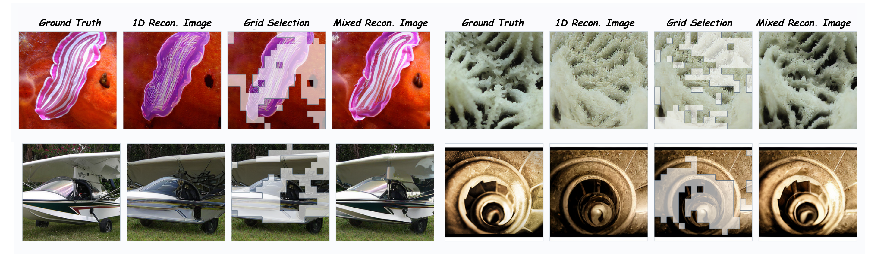
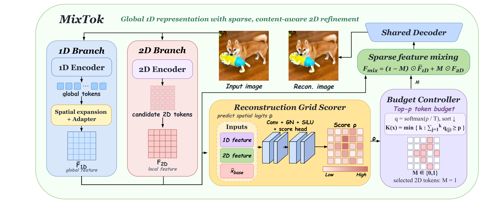
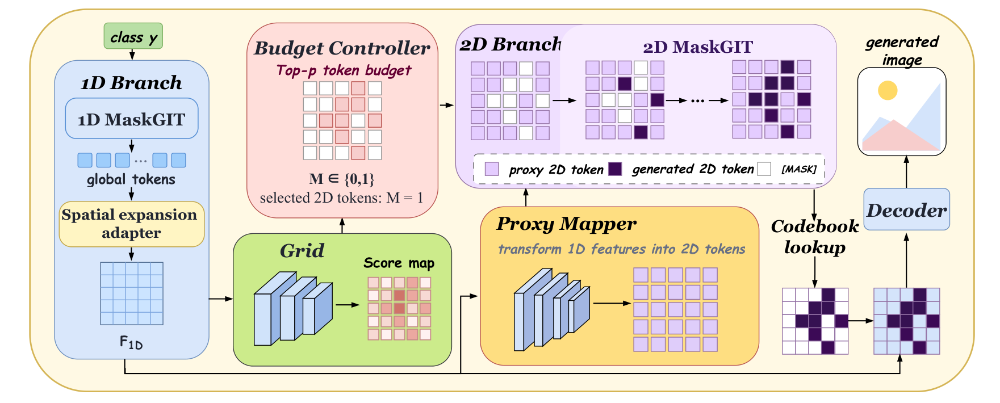

# MixTok: Content-Adaptive 1D–2D Visual Tokens for Reconstruction and Generation

MixTok represents an image with **32 global 1D tokens** and a variable number of **spatial 2D refinement tokens**. A learned scorer ranks locations on a 16 × 16 grid, and top-p selection decides how many locations to refine for each image. The same mixed representation supports ImageNet reconstruction and class-conditional generation.

  

*ImageNet validation examples. Each group shows ground truth, 1D-only reconstruction, selected 2D grid locations in white, and the mixed reconstruction after refinement.*

**Start here:** [Reconstruction guide](reconstruction/README.md) · [Generation guide](generation/README.md) · [Required assets](#data-and-checkpoints) · [Training and evaluation](#reconstruction)

## How MixTok works

1. **Global representation.** TiTok-L32 encodes 32 1D tokens. An adapter expands them into a continuous 16 × 16 feature grid.
2. **Adaptive refinement.** A scorer ranks the 256 grid locations. After temperature-scaled softmax, top-p selects the smallest ranked prefix whose cumulative probability reaches `p`. The selected count `K(x)` changes with each image.
3. **Mixed decoding.** Selected locations receive 2D codebook features; unselected locations keep their continuous 1D-derived features. A shared decoder renders the mixed grid.

  

*MixTok reconstruction overview. The scorer and top-p controller select spatial locations for 2D refinement.*

For **generation**, a TiTok MaskGIT first samples the 32 1D IDs. A scorer selects spatial locations using their 1D feature grid. An embedding adapter maps that grid into continuous Halton context embeddings, and sparse Halton MaskGIT generates 2D IDs only at the selected locations. Unselected decoder locations keep their continuous 1D-derived features.

  

*Class-conditional generation with continuous spatial context embeddings. The adapter maps 1D features into the 2D MaskGIT input space; only selected 2D tokens are generated.*

The fixed **96/256** allocation belongs to reconstruction warm-start training. Final reconstruction and generation use image-dependent top-p selection, so the number of selected 2D locations changes with each image.

## Repository map

| Directory | Main purpose | Start here |
| --- | --- | --- |
| [`reconstruction/`](reconstruction/) | Adapter, fixed-budget warm-start, end-to-end top-p reconstruction, and ImageNet validation | [Reconstruction guide](reconstruction/README.md) |
| [`generation/`](generation/) | Continuous-embedding sparse 2D MaskGIT, CFG sweep, and generation evaluation | [Generation guide](generation/README.md) |

Each component is run from **its own directory**. Configuration paths are relative to that working directory; for example, `../ImageNet/train` in a reconstruction YAML means `MixTok/ImageNet/train`. The two components have different software environments.

## Data and checkpoints

Keep large files out of Git. The root `.gitignore` excludes the directories below. You may use directories or symlinks; the paths consumed by the checked-in configs stay relative to this repository.

~~~text
MixTok/
├── reconstruction/           # source and YAML configs
├── generation/               # source, scripts, and vendored adapters
├── 1d-tokenizer/             # upstream TiTok source and public L32 weights
├── LlamaGen/                 # upstream LlamaGen source and public VQ weights
├── Halton-MaskGIT/source/    # upstream Halton source
├── ImageNet/
│   ├── train/
│   └── validation/
├── assets/
│   ├── reconstruction/       # evaluated top-p checkpoint when supplied
│   └── generation/           # Halton init, scorer, teacher/route caches, FID assets
└── results/                  # generation runs and evaluations
~~~

The repository does **not** redistribute ImageNet, trained checkpoints, generated token/condition caches, or ADM FID reference files. The generation asset manifest at [`generation/configs/h20_assets.json`](generation/configs/h20_assets.json) retains local paths, sizes, and SHA-256 values. Assets without a public source must be supplied separately and verified against those values.

### Checkpoint handoff

| Artifact | Used by | Expected location or identity |
| --- | --- | --- |
| Public TiTok-L32 and LlamaGen VQ weights | Reconstruction training and evaluation | Under `1d-tokenizer/` and `LlamaGen/`; [public-weight helper](reconstruction/download_public_weights.py) |
| Fixed 20-epoch reconstruction checkpoint | Top-p reconstruction initialization | `reconstruction/weights/epoch_0020_step_00199440.pt` by default; SHA-256 `86c8f9da5e61261ab93066c73d7719203e8c00b69f05b805c5937e6b7319b446` |
| Evaluated top-p checkpoint at step 247482 | Reconstruction validation and generation conditioning | Set the evaluation `ckpt` path and generation `TOP_P_CKPT` to the same file; SHA-256 `61e6e22acf5e4f7dcf44158518e4061a3fc9d6ca481ddc753e97f822546cb819` |
| Official Halton initialization | Generation training | `assets/generation/ImageNet_256_base.pth` in the example below; SHA-256 `7fe25cb80b05743e8b42dacc61d88792a9ab5217d6bd756bef28821e0a5fc68f` |
| Top-p scorer, teacher-proxy and route caches, GT codes, ADM reference | Embedding generation training and evaluation | Supply under `assets/generation/`; training creates the continuous adapter checkpoint |

The generation code checks the TiTok and top-p checkpoint hashes in [`assets_top_p.py`](generation/experiments/continuous_halton_embedding_20260923/assets_top_p.py). Do not replace these with earlier fixed-budget or k-selector weights.

## Reconstruction

### Environment and public weights

From the repository root:

~~~bash
cd reconstruction
conda env create -n mot-reconstruction -f environment.yml
conda activate mot-reconstruction
python download_public_weights.py \
  --project-root .. \
  --torch-cache-root ../.cache/torch
~~~

The source checkouts and ImageNet tree must occupy the paths shown above. If they are stored elsewhere, update the corresponding relative paths in the YAML files. [`reconstruction/README.md`](reconstruction/README.md) lists the expected upstream modules.

### Training stages

| Stage | Config | Output / handoff |
| --- | --- | --- |
| 1. Train the 1D-to-grid adapter for 2.5 epochs | `configs/adapter_only_2p5epoch.yaml` | `results/adapter_only_2p5epoch/latest.pt` |
| 2. Train a fixed top-96 scorer/refiner for 20 epochs | `configs/fixed96_from_adapter_20epoch.yaml` | Fixed-budget checkpoint; its adapter input is Stage 1 EMA |
| 3. Train end-to-end dynamic top-p for six epochs | `configs/top_p_train.yaml` | `results/top_p_from_fixed_6epoch/`; training uses `p=0.91`, `T=2` |

Run each stage from `reconstruction/` with eight visible GPUs:

~~~bash
CUDA_VISIBLE_DEVICES=0,1,2,3,4,5,6,7 torchrun --standalone --nproc_per_node=8 \
  train_titok_llamagen_recon.py --config configs/adapter_only_2p5epoch.yaml

CUDA_VISIBLE_DEVICES=0,1,2,3,4,5,6,7 torchrun --standalone --nproc_per_node=8 \
  train_titok_llamagen_decoder_adapt_router_f2d_e2e_dynamic.py \
  --config configs/fixed96_from_adapter_20epoch.yaml

# First set "resume" in configs/top_p_train.yaml to the Stage 2 checkpoint.
CUDA_VISIBLE_DEVICES=0,1,2,3,4,5,6,7 torchrun --standalone --nproc_per_node=8 \
  train_titok_llamagen_decoder_adapt_router_f2d_e2e_dynamic.py \
  --config configs/top_p_train.yaml
~~~

Stage 3 runs for 6 epochs. It defaults to `weights/epoch_0020_step_00199440.pt`; if Stage 2 produced a different filename, change `resume` before launching.

### Validation

Put the checkpoint to evaluate at the `ckpt` path in the selected YAML. Both evaluation configs use EMA weights, dynamic top-p with `p=0.994897` and `T=1`, and no fixed token clamp (`router_min_tokens=router_max_tokens=-1`).

~~~bash
CUDA_VISIBLE_DEVICES=0 python \
  eval_titok_llamagen_mix_metrics_router_f2d_e2e_dynamic.py \
  --config configs/top_p_eval_5000.yaml

CUDA_VISIBLE_DEVICES=0 python \
  eval_titok_llamagen_mix_metrics_router_f2d_e2e_dynamic.py \
  --config configs/top_p_eval_50000.yaml
~~~

The 50k config writes `results/top_p_eval_50000.json`. Its `no_ssim: true` setting means that the reference run does not report SSIM.

## Generation

Generation uses **continuous embedding**. It needs the same evaluated top-p reconstruction checkpoint, the accepted 1D-feature scorer, a paired top-p GT code cache, a teacher-proxy cache for adapter training targets, and a route-only cache for sparse 2D training. See the [generation guide](generation/README.md) for the cache contract and source layout.

Use a separate Python 3.10/CUDA environment with PyTorch **2.10.0**, torchvision **0.25.0**, and the packages in [`requirements-h20.txt`](generation/requirements-h20.txt) and [`constraints-h20.txt`](generation/constraints-h20.txt). The training scripts target eight H20 GPUs and log to W&B offline by default; online logging is optional. From `generation/`, `python -m h20.preflight --environment-only` checks the pinned runtime versions.

After supplying the external assets, run these commands from the repository root. The `MOTAR_*` environment variable names are part of the script interface:

~~~bash
cd generation
export MOTAR_ASSETS=../assets/generation
export MOTAR_RESULTS=../results/generation
export HALTON_UPSTREAM_ROOT=../Halton-MaskGIT/source
export HALTON_OFFICIAL_CKPT=../assets/generation/ImageNet_256_base.pth
export TOP_P_CKPT=../assets/reconstruction/epoch_0006_step_00247482.pt
export TOP_P_SCORER_CKPT=../assets/generation/top_p_scorer/latest.pt
export TOP_P_GT2D_CACHE=../assets/generation/gt2d_top_p_train
export TOP_P_TEACHER_PROXY_CACHE=../assets/generation/teacher_proxy_top_p_train
export TOP_P_ROUTE_CACHE=../assets/generation/top_p_continuous_route_cache

bash scripts/launch_continuous_adapter20k.sh
export CONTINUOUS_ADAPTER_CKPT="$MOTAR_RESULTS/continuous_adapter20k_seed20260918/latest.pt"
bash scripts/launch_continuous_halton20k.sh

python experiments/continuous_halton_embedding_20260923/sweep_cfg.py \
  --checkpoint "$MOTAR_RESULTS/continuous_halton20k_seed0/latest.pt" \
  --adapter-checkpoint "$CONTINUOUS_ADAPTER_CKPT" \
  --scorer-checkpoint "$TOP_P_SCORER_CKPT" \
  --top-p-checkpoint "$TOP_P_CKPT" \
  --output "$MOTAR_RESULTS/continuous_cfg_sweep"
~~~

The first launcher trains the continuous adapter, the second trains the sparse 2D MaskGIT, and the sweep selects CFG on a fixed 5k cohort before the 50k evaluation. Each training stage stops at 20,000 optimizer updates and writes `latest.pt`.

## Reproducibility and credits

The source tree and configuration paths can be inspected without the external assets. Training and evaluation require the checkpoints, caches, ImageNet split, and FID assets above. Third-party code under `generation/third_party/` keeps its original provenance and license files.
